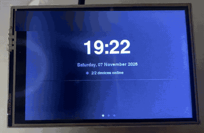
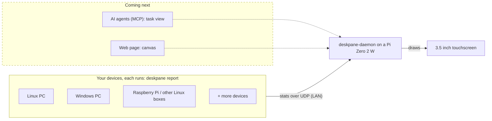

# deskpane

**A small screen on your desk that shows what your computers put on it.** Live CPU, memory,
disk and temperature for every PC on your network, on a Raspberry Pi with a 3.5 inch
touchscreen. Soon your AI agents can put a task list on it too.

<p align="center"></p>



Each computer sends a small report every 4 seconds. The Pi shows an overview page, then one
page per device. Tap the screen to change page.

## Quick start

From v0.1.0-beta.2. On the Pi (64-bit Raspberry Pi OS Bookworm or later, screen fitted):

```bash
curl -fsSL https://raw.githubusercontent.com/nokri-mohammed/deskpane/main/get.sh | sudo bash
```

You can read the script first at
[that URL](https://raw.githubusercontent.com/nokri-mohammed/deskpane/main/get.sh). It checks
every download against the release's `SHA256SUMS` before it runs anything.

On each other computer, get `deskpane` from the
[releases page](https://github.com/nokri-mohammed/deskpane/releases) and run it with your
Pi's IP address:

```bash
deskpane report --daemon 192.168.1.50:8765
```

The device id is made from the machine id and the label is the hostname; add
`--device-id my-pc --label "My PC"` to pick your own.

Step by step for Linux, Windows and a manual install: [docs/INSTALL.md](docs/INSTALL.md).

## What you need

- Raspberry Pi Zero 2 W, with a pin header
- Elegoo 3.5" SPI touchscreen (an LCD35 clone)
- microSD card
- 5 V micro USB power supply

Parts and links: [docs/HARDWARE.md](docs/HARDWARE.md).

## Roadmap

- **Now:** live stats from the computers on your network.
- **Next:** a task view that AI agents keep up to date over MCP.
- **Later:** a free canvas that you design in a web page.

**Status: beta.** Expect changes between releases. There is no authentication yet, so use it
on a home network you trust ([SECURITY.md](SECURITY.md)).

## Docs

[Install](docs/INSTALL.md) · [Hardware](docs/HARDWARE.md) · [JSON contract](docs/CONTRACT.md) ·
[Security](SECURITY.md) · [Contributing and design](CONTRIBUTING.md) · [Changelog](CHANGELOG.md)

## License

MIT, see [LICENSE](LICENSE).
