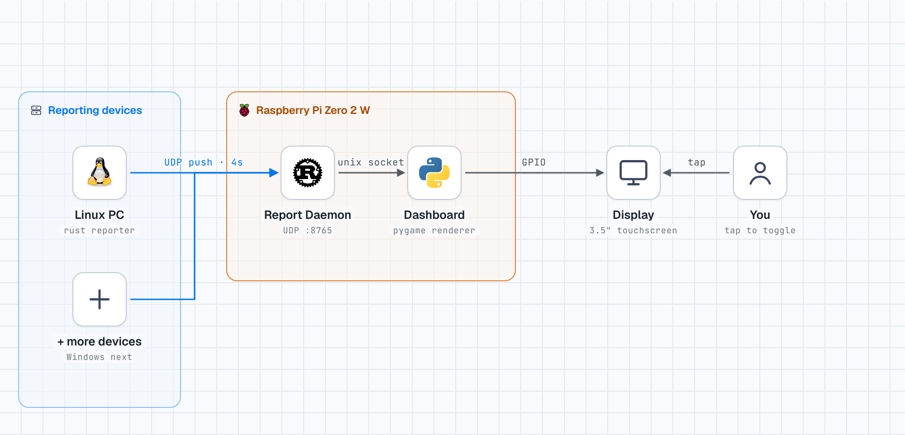

# pi-homelab-dashboard

A Raspberry Pi Zero 2 W drives a small Waveshare 3.5" touchscreen showing
live stats — not just for itself, but for any device on the homelab that
reports in. Tap the screen to cycle between devices.



## How it works

- **Reporting devices** run a small Rust binary that reads local system
  stats (CPU, RAM, disk, temperature, uptime) and pushes them to the Pi
  every few seconds over **UDP**. First target: Linux (via the
  [`sysinfo`](https://docs.rs/sysinfo) crate for cross-platform stats,
  installed as a systemd unit). Windows is next — same binary, same
  contract, a Windows Service instead of a unit.
- **The Pi runs a Rust daemon** that accepts those pushes and keeps the
  latest report per device in memory, marking a device offline if it stops
  reporting. **v1 has no authentication** — plain UDP, fine on a trusted
  LAN, not fine beyond it. The daemon's `PROTOCOL` is a single switch point
  for adding TCP and then TCP+mTLS later (the private CA already exists in
  `pi-homelab-ca`, just not wired in yet) without restructuring anything
  else.
- That daemon relays the same data **locally over a Unix domain socket** —
  no TLS needed for that hop, filesystem permissions are the access
  control. This keeps the daemon and the UI as two independent processes
  without needing a second network port.
- **The Pi's dashboard** is Python + pygame, reading that socket and
  drawing animated gauges straight to the framebuffer (no X11 — this is a
  plain SPI panel, not a DRM-capable display). A background thread watches
  the touchscreen's raw evdev events and flips between pages on a tap.

See [`docs/CONTRACT.md`](docs/CONTRACT.md) for the exact JSON shape every
device sends, and the diagram above (also at
[`docs/diagram/source.html`](docs/diagram/source.html), built with
[stack-diagram](https://github.com/caru-ini/stack-diagram)) for the full
picture.

## Why this shape

- **Push, not poll**: the Pi doesn't need to know about a device in
  advance or SSH into it — any device that starts sending reports shows up,
  and the dashboard's page rotation grows automatically.
- **Rust for anything network-facing or running unattended on someone
  else's machine** (the daemon, every reporter): a single static binary,
  no runtime to install, memory-safe for code parsing input from the
  network. **Python for the UI only**, where pygame's drawing API and fast
  iteration matter more than raw performance.
- **UDP first, deliberately minimal**: getting one working end-to-end path
  (reporter → daemon → socket → display) proven before adding auth. Once
  that's solid, swapping UDP for TCP+mTLS is a change to one function, not
  a redesign — the CA infrastructure (`pi-homelab-ca`) is already built and
  waiting for that step.

## Repo layout

```
pi/           Dashboard (Python/pygame) — runs on the Pi, owns the display
daemon/       Report daemon (Rust) — runs on the Pi, owns the network and
              the contract module (daemon/src/contract.rs: the Report/
              DeviceStatus types), since the daemon is the interface
              reporters report into
reporter/     Stats reporter (Rust) — runs on every reporting device,
              depends on daemon as a library for the contract types
docs/         CONTRACT.md (the JSON shape devices report in), HARDWARE.md,
              RECOVERY.md, and diagram/ (architecture diagram source +
              rendered PNGs)
scripts/      provision-pi.sh — pushes this repo onto a freshly-flashed Pi
```

`daemon/` and `reporter/` are one Cargo workspace — one `Cargo.toml` at the
repo root, one `Cargo.lock`. `reporter` depends on `daemon` only for its
`contract` module (the shared `Report`/`DeviceStatus` types); it doesn't
run any of the daemon's networking code.

The private CA lives in a separate sibling repo,
[`pi-homelab-ca`](../pi-homelab-ca) — kept out of this repo entirely so it
never risks being pushed anywhere public.

## Status

Working today:
- Pi display pipeline: framebuffer rendering (`pi/fb_display.py`), touch
  detection (`pi/touch.py`), console autostart on boot.
- Private CA + cert issuance scripts, in the sibling `pi-homelab-ca` repo
  (generated, not wired into the daemon yet — see Not built yet).
- Reporting contract defined (`docs/CONTRACT.md`).
- `daemon/` — UDP report listener + in-memory state + Unix socket
  broadcaster, plus the shared `contract` module. Builds and runs; tested
  end-to-end with a fake UDP report in dev.
- `reporter/` — CLI (`clap`), `reporter run --daemon <addr> --device-id
  <id> --label <name> [--interval <secs>]` reads real stats via `sysinfo`
  (CPU/RAM/disk/hostname/uptime) and loops, pushing over UDP. Tested
  end-to-end against the daemon with real stats from this dev machine.
- `pi/dashboard.py` — reads the daemon's Unix socket in a background
  thread (auto-reconnects if the daemon isn't up yet), renders one device
  per page onto `fb_display.FrameBuffer` (bars for CPU/mem/disk, label,
  hostname, ip, uptime, online/offline), cycles pages via
  `touch.TouchWatcher`. Tested end-to-end (socket → daemon → reporter →
  rendered pixel buffer) against a scratch file standing in for
  `/dev/fb1` — not yet confirmed on the real touchscreen.

Not built yet:
- `reporter report` (one-shot) and `reporter install`/`uninstall`
  (systemd unit on Linux, Windows Service on Windows) — `run` is the only
  subcommand so far.
- Per-OS temperature (`temp_c` is hardcoded to `0.0` for now).
- TCP+mTLS transport for the daemon (`PROTOCOL` currently only supports
  `udp`).
- Running any of this on the actual Pi / real touchscreen — everything so
  far has been proven on dev hardware only.

## Releases

Pushing a tag like `v0.2.0` triggers [`.github/workflows/release.yml`](.github/workflows/release.yml),
which cross-builds `daemon` and `reporter` for every supported target
(Pi/aarch64, Linux x86_64, Windows x86_64) and attaches them to a GitHub
Release as downloadable `.tar.gz` artifacts:

```bash
git tag v0.2.0
git push origin v0.2.0
```

Every push/PR to `main` also runs [`.github/workflows/ci.yml`](.github/workflows/ci.yml)
(`cargo build` + `cargo test` for the whole workspace).

## Setup (once the above is built)

1. Build and run `daemon/` — from the workspace root:
   `cargo run -p daemon` (env vars: `LISTEN_ADDR` default `0.0.0.0:8765`,
   `SOCKET_PATH` default `/tmp/pi-homelab-dashboard.sock`).
2. Run `pi/dashboard.py` alongside it, reading the same `SOCKET_PATH`.
3. On each reporting device: `cargo run -p reporter -- run --daemon
   <pi-ip>:8765 --device-id <id> --label <name>` (native build for Linux;
   cross-compiled with `mingw-w64` for Windows via
   `--target x86_64-pc-windows-gnu`). `install` for running it as a
   persistent service is a planned increment.
4. Once TCP+mTLS lands: in `pi-homelab-ca`, `make_ca.sh` once, then
   `issue_cert.sh pi server` and `issue_cert.sh <device-id> client` per
   device.

## License

MIT — see [`LICENSE`](LICENSE).
