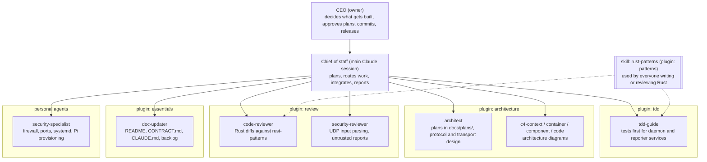

# Team

Who does what on pi-homelab-dashboard. Update the diagram when an executive or plugin is added
or removed, and add a log line every time an executive works on the project.

## Involvement log

| Date | Who | What |
|---|---|---|
| 2026-11-07 | chief of staff | Rust refactor: generic `services/` (UDP, Unix socket, broadcaster, system stats) with unit tests, shared UDP code in the daemon library |
| 2026-11-07 | security-specialist | Security review of the daemon: 2 HIGH, 4 MEDIUM, 2 LOW findings (backlog T-002 to T-006) |
| 2026-11-07 | chief of staff | Onboarded the team: architecture, tdd, review, patterns, essentials; wrote the CLAUDE.md briefing, backlog and this file |
| 2026-11-07 | chief of staff | Reviewed open-source readiness, drafted the v0.1.0 release plan |
| 2026-11-07 | chief of staff | Release phase 1: scrubbed private values and the unlicensed overlay from all history; phase 2: one workspace version, release-please |
| 2026-11-07 | tdd-guide | T-002: report validation in the daemon (37 tests, test first), try/except around dashboard drawing, limits in CONTRACT.md |
| 2026-11-07 | security-reviewer | Pre-publish review of the cleanup: history clean, overlay gone; findings logged as T-010, T-011, T-012 |
| 2026-11-07 | architect | Reviewed versioning setup (fixes in T-010, T-013, T-014), designed phase 3 release artifacts (docs/plans/2026-11-07-release-artifacts.md) |
| 2026-11-07 | code-reviewer | Reviewed T-002: changes needed (reporter can send reports the daemon rejects, test gaps); sent back to tdd-guide |
| 2026-11-07 | tdd-guide | T-002 review fixes: empty hostname allowed, out-of-range temps read as 0, 7 more tests (83 total), dashboard log rate limit |
| 2026-11-07 | code-reviewer | Re-reviewed T-002: approved; three small follow-ups (log flood guard, test message, infinity test) |
| 2026-11-07 | tdd-guide | T-002 follow-ups: log flood guard, test message, infinity test (84 tests) |
| 2026-11-07 | tdd-guide | T-003: device table capped at 32, forgets after 5 min silence, 1500-byte UDP buffer (92 tests) |
| 2026-11-07 | code-reviewer | Reviewed T-003: approved, four polish items; follow-ups T-015, T-016 |
| 2026-11-07 | tdd-guide | T-003 polish: wording, log line, saturating time math, 2 more tests (94 total) |
| 2026-11-07 | doc-updater | T-012 docs pass: CLAUDE.md, README status, CONTRACT.md offline sentence, release plan rows, em dashes removed |
| 2026-11-07 | architect | Built T-010, T-011 and phase 3: draft-then-publish release workflow, CI checks, Pi bundle with install.sh, systemd units under deploy/ |
| 2026-11-07 | security-reviewer | Reviewed release workflows: safe to merge, all action pins verified; fixes: persist-credentials false, explicit publish if, env for matrix.target, pinned toolchain |
| 2026-11-07 | security-specialist | Reviewed the Pi install package: caution, 4 must-fix (groups, env file mode, [all] in config.txt, unit sandboxing) plus 6 cheap fixes; rest deferred to T-006 |
| 2026-11-07 | doc-updater | Phase 4 first pass: INSTALL.md, SECURITY.md, CONTRIBUTING.md, CODE_OF_CONDUCT.md, issue and PR templates |
| 2026-11-07 | architect | Applied the 14 security review fixes (groups, env mode, [all] block, unit sandboxing, rollback keep, input checks, workflow token and toolchain pin) |
