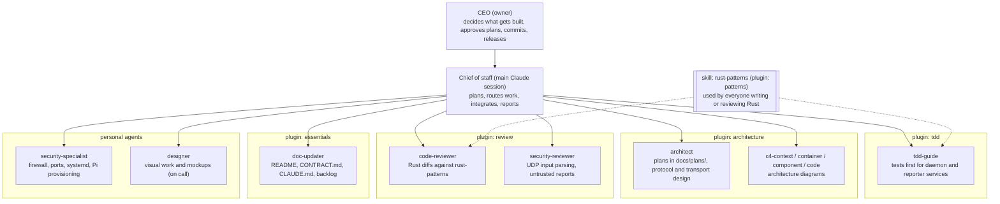

# Team

Who does what on deskpane (formerly pi-homelab-dashboard). Update the diagram when an executive or plugin is added
or removed, and add a log line every time an executive works on the project.

## Involvement log

| Date | Who | What |
|---|---|---|
| 2026-11-07 | chief of staff | Rust refactor: generic `services/` (UDP, Unix socket, broadcaster, system stats) with unit tests, shared UDP code in the daemon library |
| 2026-11-07 | security-specialist | Security review of the daemon: 2 HIGH, 4 MEDIUM, 2 LOW findings (backlog T-002 to T-006) |
| 2026-11-07 | chief of staff | Onboarded the team: architecture, tdd, review, patterns, essentials; wrote the CLAUDE.md briefing, backlog and this file |
| 2026-11-07 | chief of staff | Reviewed open-source readiness, drafted the v0.1.0 release plan |
| 2026-11-07 | chief of staff | Release phase 1: scrubbed private values and the unlicensed overlay from all history; phase 2: one workspace version, release-please |
| 2026-11-07 | tdd-guide | T-002: report validation in the daemon (37 tests, test first), try/except around dashboard drawing, limits in CONTRACT.md |
| 2026-11-07 | security-reviewer | Pre-publish review of the cleanup: history clean, overlay gone; findings logged as T-010, T-011, T-012 |
| 2026-11-07 | architect | Reviewed versioning setup (fixes in T-010, T-013, T-014), designed phase 3 release artifacts (docs/plans/2026-11-07-release-artifacts.md) |
| 2026-11-07 | code-reviewer | Reviewed T-002: changes needed (reporter can send reports the daemon rejects, test gaps); sent back to tdd-guide |
| 2026-11-07 | tdd-guide | T-002 review fixes: empty hostname allowed, out-of-range temps read as 0, 7 more tests (83 total), dashboard log rate limit |
| 2026-11-07 | code-reviewer | Re-reviewed T-002: approved; three small follow-ups (log flood guard, test message, infinity test) |
| 2026-11-07 | tdd-guide | T-002 follow-ups: log flood guard, test message, infinity test (84 tests) |
| 2026-11-07 | tdd-guide | T-003: device table capped at 32, forgets after 5 min silence, 1500-byte UDP buffer (92 tests) |
| 2026-11-07 | code-reviewer | Reviewed T-003: approved, four polish items; follow-ups T-015, T-016 |
| 2026-11-07 | tdd-guide | T-003 polish: wording, log line, saturating time math, 2 more tests (94 total) |
| 2026-11-07 | doc-updater | T-012 docs pass: CLAUDE.md, README status, CONTRACT.md offline sentence, release plan rows, em dashes removed |
| 2026-11-07 | architect | Built T-010, T-011 and phase 3: draft-then-publish release workflow, CI checks, Pi bundle with install.sh, systemd units under deploy/ |
| 2026-11-07 | security-reviewer | Reviewed release workflows: safe to merge, all action pins verified; fixes: persist-credentials false, explicit publish if, env for matrix.target, pinned toolchain |
| 2026-11-07 | security-specialist | Reviewed the Pi install package: caution, 4 must-fix (groups, env file mode, [all] in config.txt, unit sandboxing) plus 6 cheap fixes; rest deferred to T-006 |
| 2026-11-07 | doc-updater | Phase 4 first pass: INSTALL.md, SECURITY.md, CONTRIBUTING.md, CODE_OF_CONDUCT.md, issue and PR templates |
| 2026-11-07 | architect | Applied the 14 security review fixes (groups, env mode, [all] block, unit sandboxing, rollback keep, input checks, workflow token and toolchain pin) |
| 2026-11-07 | architect | T-022: vision, views architecture, MCP task view and canvas design, roadmap, name shortlist (recommends deskpane), rename impact |
| 2026-11-07 | architect | T-023: renamed to deskpane (binaries, command, paths, units, user, downloads, docs), all checks and fake-root flow pass |
| 2026-11-07 | designer | T-024 started (capture script, concept mockups), stopped: the CEO will provide the images |
| 2026-11-07 | architect | Beta release config: first release 0.1.0-beta.1 as a GitHub pre-release, path to 0.1.0 final documented |
| 2026-11-07 | doc-updater | T-029: README rewritten as a short pitch (180 to 81 lines) with hook, image spot and context diagram; details moved to CONTRIBUTING.md, CONTRACT.md, SECURITY.md |
| 2026-11-07 | architect | T-028: one-line installer get.sh (newest release incl. betas, hash check, old-install removal, port check, auto reboot, --reporter-only), same checks in install.sh, INSTALL.md quick install |
| 2026-11-07 | security-specialist | Reviewed T-028 get.sh: caution, no must-fix, 6 cheap fixes (env hygiene, Pi --reporter-only guard, TLS error message, client unit hardening, reboot wording, leftover-files line); deferred T-030, T-031 |
| 2026-11-07 | architect | T-028 security fixes: env hygiene (DESKPANE_DESTDIR, curl -q, fixed tmp dir), Pi guard for --reporter-only, clearer network error, client unit hardening (1.7 OK), INSTALL.md wording, RECOVERY.md note |
| 2026-11-07 | architect | beta.3 design (docs/plans/2026-11-07-beta3-ids-and-screen.md): automatic ids, duplicate rejection with replies, port-in-use exit, screen changes |
| 2026-11-07 | tdd-guide | beta.3 build test first: T-027 port-in-use exit, T-032 automatic ids, T-033 duplicate rejection with replies and --once, installers, T-034 screen (198 Rust + 18 Python tests) |
| 2026-11-07 | code-reviewer | Reviewed beta.3: approve with follow-ups (get.sh re-run order, keep ids on client upgrade, Windows ConnectionReset, CI Windows check, --once message) |
| 2026-11-07 | security-reviewer | Reviewed beta.3 replies: caution, no amplification or limiter flush; must-fix SECURITY.md; fixes: back-off instead of permanent stop, limiter const test, bounded drain, absolute reg.exe path |
| 2026-11-07 | doc-updater | beta.3 SECURITY.md: daemon replies and their limits, device ids, reply spoofing and squatting until v0.2.0, exit codes |
| 2026-11-07 | tdd-guide | beta.3 review fixes: reporter backs off 5 min instead of stopping, get.sh check before writing and keeps saved ids, Windows CI check, bounded reply reads, absolute reg.exe path (221 Rust + 18 Python tests) |
| 2026-11-08 | architect | Idea 1 agent status view: design plan (hooks to `deskpane agent`, agent packet on 8765, agent table, agents page), 6 CEO decisions, tasks T-038 to T-049 |
| 2026-11-08 | architect | Agent status plan approved; added character packs (section 10), error state, T-038 spike results; new tasks T-050 to T-053 |
| 2026-11-08 | tdd-guide | Agent status Rust side started: T-039 contract, T-040 agent table, T-041 daemon wiring, T-042 hook client, T-043 hook setup |
| 2026-11-08 | tdd-guide | Agent status screen and characters started: T-044 dashboard, T-050 charpack helpers, T-051 pack install, T-052 sprites, T-053 license guards |
| 2026-11-08 | tdd-guide | Agent status Rust side done: T-039 to T-043 test first (221 to 405 Rust tests), silent_s, settings backup fix |
| 2026-11-08 | tdd-guide | Agent status screen and characters done: T-044, T-050 to T-053 (18 to 169 Python tests), real pack validated, renders |
| 2026-11-08 | code-reviewer | T-045 review: approve with follow-ups; 2 MEDIUM (symlinked settings.json and temp file mode, parallel subagents hide needs_you), 6 LOW |
| 2026-11-08 | security-reviewer | T-045 review: caution; 2 MEDIUM (settings backups world-readable, home folder name leaks as project), 8 LOW; SECURITY.md needs 4 new sections |
| 2026-11-08 | security-specialist | T-045 install review: caution, 2 must-fix (get.sh order before pack check, install.sh must not die on pack failure), 8 cheap fixes, 3 deferred |
| 2026-11-08 | designer | Agents page visual pass: hinting-free small text (fixes "homel ab"), emote clear of the head, NEEDS YOU badge, card hierarchy; dashboard.py only |
| 2026-11-08 | tdd-guide | T-045 Rust fix round started: settings file modes and symlinks, home folder project, parallel subagent needs_you (sub field), table and log fixes |
| 2026-11-08 | tdd-guide | T-045 install fix round started: get.sh check order, install.sh pack failure, zip open by fd, rollback, fsync, licence guard |
| 2026-11-08 | tdd-guide | T-045 install fix round done: get.sh checks the pack first, install.sh survives a pack failure, zip read once by fd, swap rollback, fsync, CDPATH-safe paths, stronger licence guard (172 to 193 Python tests) |
| 2026-11-08 | tdd-guide | Page and focus logic moved from dashboard.py into tested layout.py helpers (code-review LOW 3) started |
| 2026-11-08 | tdd-guide | T-045 Rust fix round done: settings files 0600 and symlink-safe, home folder hidden, parallel subagent needs_you (sub key), recently ended, takeover cap, log fixes (405 to 443 Rust tests) |
| 2026-11-08 | tdd-guide | Page and focus logic moved into tested layout.py and charpack.py helpers, screen pixel-identical (193 to 213 Python tests) |
| 2026-11-08 | code-reviewer | T-045 final pass: approve, no HIGH or MEDIUM; 4 small pi fixes and an optional per-key reorder time (T-054) |
| 2026-11-08 | doc-updater | T-046 docs for the agent view and character packs: CONTRACT, INSTALL, SECURITY (4 sections), new CHARACTERS, README, IDEAS, CONTRIBUTING, backlog |
| 2026-11-08 | doc-updater | T-046 docs: CONTRACT.md agent packet and socket line, INSTALL.md hook setup and --characters, SECURITY.md four sections, new CHARACTERS.md, README, IDEAS, CONTRIBUTING |
| 2026-11-08 | tdd-guide | Four small drawing fixes: clip restored on error, focus return kept, text measure cache with smaller cap for big fonts, pygame note (214 Python tests, screens pixel-identical) |
| 2026-11-08 | security-reviewer | T-045 re-check of the fix round started (settings files, home folder, sub field, recently ended, zip install) |
| 2026-11-08 | security-reviewer | T-045 re-check: safe to commit, no CRITICAL/HIGH/MEDIUM; 4 LOW logged (T-054, T-055) |
| 2026-11-08 | chief of staff | Committed the agent status view as 4 commits on feat/agent-status-view, pushed, opened the pull request |
| 2026-11-08 | chief of staff | PR #4 merged to main (rebase, 5 commits); CI caught an IPv4 versus IPv6 hostname bug in send_datagram, fixed with pick_address |
| 2026-11-10 | architect | Plan for T-060 to T-064 (local preview, agent row line 3, model and tokens, replay after a Pi restart, PiSugar battery): docs/plans/2026-11-10-battery-agent-details-preview.md |
| 2026-11-10 | tdd-guide | T-061 local preview built test first: pi/display.py backends, mock daemon, scenarios, scripts/preview.sh, golden envelope fixture; 448 Rust and 249 Python tests green; headless frames checked by eye (uncommitted) |
| 2026-11-10 | tdd-guide | T-064 PiSugar battery built test first: pisugar socket client (fixed get lines only), battery_pct, charging and local in the contract, battery icon on the overview and device page, reporter unit group pisugar plus install.sh group, INSTALL.md section pending security setup; 481 Rust and 273 Python tests, preview and loopback checked by eye (uncommitted) |
| 2026-11-10 | tdd-guide | T-061/T-064 review fixes test first: BATTERY from the env file (unit passes no --battery, rollback safe), PiSugar INSTALL steps checked against the unpacked 2.4.1 deb and source (model names, absolute --config, enable), one 300 ms battery budget per cycle, preview Host guard and stop lock, mock without model/tokens, hostname clipped clear of the battery; 489 Rust and 279 Python tests, fmt, clippy Linux and Windows, headless battery preview (uncommitted) |
| 2026-11-10 | architect | T-066 carrier board plan (block diagram, BQ24074 + TPS61088 + MAX17048, BOM with LCSC prices, JLCPCB flow, bring-up order, overlay and `--battery fuelgauge` reader, Li-ion safety, costs): docs/plans/2026-11-10-carrier-board.md |
| 2026-11-11 | architect | T-067 plugin system plan (contract-defined panels and data sources, merge-gated trust, declarative-first render, narrow host API, preview as test harness, phased WASM sandbox and store last): docs/plans/2026-11-11-plugin-system.md |
| 2026-11-11 | security-specialist | T-067 plugin plan security review: 4 HIGH (format-string eval hole in declarative panels, allowlisted_get SSRF/DNS-rebind, CI scan weakness, benign-now-malicious-later), 3 MEDIUM, 2 LOW; verdict Phase 0 safe to build, HIGH items are Phase 2 gates |
| 2026-11-11 | chief of staff | Folded the security review into docs/plans/2026-11-11-plugin-system.md (Phase 2 security done-bars, section 7 supply-chain control, corrected the weather example format string) and created docs/SECURITY.md (WASM-sandbox trigger invariant, review-checklist additions, the four HIGH runtime controls) |
| 2026-11-11 | chief of staff | T-067 Phase 0 part 1: extracted the wire contract into its own deskpane-contract crate (lib deskpane_contract), daemon re-exports it as daemon::contract so every path is unchanged, reporter keeps working; workspace member added; 489 Rust tests pass, fmt and clippy clean (uncommitted) |
| 2026-11-11 | chief of staff | T-067 Phase 0 part 2: mirrored the wire contract on the Python side (new pi/deskpane_contract.py: envelope version and parse_socket_line); layout.py re-exports it and preview_scenarios.py single-sources the version; 279 Python tests pass (uncommitted) |
| 2026-11-11 | chief of staff | T-067 Phase 0 part 3: panel registry: layout.page_ring now built from a pure PAGE_PROVIDERS registry, dashboard.py dispatches drawing via a PANEL_DRAW registry (overview/agents/device), pixel-identical by construction; new tests/test_panels.py lockstep test; 282 Python tests pass, headless preview eyeballed (overview, agents, device all correct) (uncommitted) |
| 2026-11-11 | chief of staff | T-067 Phase 0 part 4: wrote the versioning and compatibility rule into docs/CONTRACT.md (shared deskpane-contract crate + Python mirror, per-surface v, additive-only within a major, feat! major bumps, plugins declare contract/host-api versions), folds in T-014. Phase 0 DONE: 489 Rust + 282 Python tests green, fmt and clippy clean (uncommitted) |
| 2026-11-11 | code-reviewer | /code-review (medium) of the uncommitted tree: 2 HIGH (pi/deskpane_contract.py missing from the Pi bundle + guard/test gap, so the dashboard would crash-loop on the Pi; local preview hid it), 1 latent (BatteryProbe pins to the deprecated plug query after one transient miss); rest of the diff clean |
| 2026-11-11 | chief of staff | Fixed all 3 review findings: added deskpane_contract.py to package-pi-bundle.sh, the install.sh bundle guard, and two test expected-file lists (real-package test now catches it); BatteryProbe switches the plug query only after PLUG_SWITCH_AFTER=3 consecutive misses (new field + 2 tests). 497 Rust + 282 Python tests, fmt + clippy clean |
