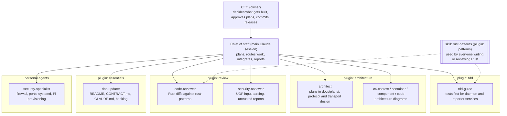

# Team

Who does what on pi-homelab-dashboard. Update the diagram when an executive or plugin is added
or removed, and add a log line every time an executive works on the project.

## Involvement log

| Date | Who | What |
|---|---|---|
| 2026-11-07 | chief of staff | Rust refactor: generic `services/` (UDP, Unix socket, broadcaster, system stats) with unit tests, shared UDP code in the daemon library |
| 2026-11-07 | security-specialist | Security review of the daemon: 2 HIGH, 4 MEDIUM, 2 LOW findings (backlog T-002 to T-006) |
| 2026-11-07 | chief of staff | Onboarded the team: architecture, tdd, review, patterns, essentials; wrote the CLAUDE.md briefing, backlog and this file |
| 2026-11-07 | chief of staff | Reviewed open-source readiness, drafted the v0.1.0 release plan |
| 2026-11-07 | chief of staff | Release phase 1: scrubbed private values and the unlicensed overlay from all history; phase 2: one workspace version, release-please |
