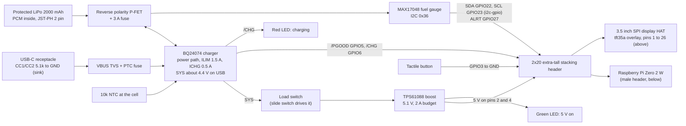

# Carrier board: one deskpane unit through the full production flow

Date: 2026-11-10. Author: architect. Status: plan only, waiting for the CEO. Ticket: T-066.
Nothing has been ordered, bought or signed up for. No code has changed.

## Goal

Build one deskpane unit for the CEO that goes through the whole production flow: a custom PCB
drawn in KiCad, made and assembled by a factory (JLCPCB recommended), fitted in a real enclosure.
The point is to learn and test the process. Not for sale, so no certification spend; section 9
lists what would change for selling.

The carrier board replaces the PiSugar S. It must give:

- a real battery percentage from an I2C fuel gauge (the PiSugar S has no gauge and cannot report
  a level),
- safe Li-ion charging from USB-C, with load sharing so the unit runs while charging,
- a 5 V boost that runs the Pi Zero 2 W plus the display backlight,
- a power button and status LEDs,
- a display connection.

## Recommended design in one line

A 65 x 30 mm 4-layer pHAT-size carrier that sits between a Pi Zero 2 W and the existing plug-in
3.5 inch SPI display HAT on an extra-tall 2x20 stacking header, with a TI BQ24074 power-path
charger, a TI TPS61088 5.1 V boost behind a load switch, a MAX17048 fuel gauge on a software I2C
bus, a protected 2000 mAh LiPo pouch cell, a slide switch for true off and a GPIO3 button for
wake and clean shutdown; assembled by JLCPCB Economic PCBA; read by deskpane through the kernel
`power_supply` class as `--battery fuelgauge`.

## 1. Block diagram

Pins the display already uses (from `docs/HARDWARE.md`): BCM 7, 8, 9, 10, 11 (SPI0), 17 (touch
IRQ), 24 (DC), 25 (reset). The carrier uses only free pins: BCM 3 (button), 5 and 6 (charger
status), 22 and 23 (fuel gauge I2C), 27 (gauge alert). 5 V goes in on physical pins 2 and 4,
ground on 6, 9, 14, 20, 25 and more.

## 2. Key decisions and recommendations

| Decision | Options | Recommendation and why |
|---|---|---|
| Compute | Pi Zero 2 W on a header, or a Compute Module (CM3/CM4/CM5) | **Pi Zero 2 W on a header.** It is what deskpane runs on today, it needs no high-speed routing (a CM needs a 100-pin Hirose connector, impedance-controlled USB/SD lines and a much harder board), and it can be moved back to the current unit. A CM only makes sense for a product with volume. |
| Board shape | Under the Pi (pogo pins), or between Pi and display | **Between them, on an extra-tall 2x20 stacking header.** The female side plugs onto the Pi's male header, the long pins come up through the carrier for the display HAT. No pogo pins, no soldering to the Pi, and the HAT works unchanged. All SMD parts on the carrier's top side, kept low (under about 6 mm) to clear the HAT socket. |
| Display | Bare 3.5 inch panel on FPC, or keep the plug-in HAT | **Keep the plug-in HAT for unit 1.** A bare panel needs an FPC connector matched to one panel vendor's pinout, an XPT2046 touch controller (or a panel that has one), a backlight driver and a new overlay with its own gamma init; `HARDWARE.md` shows how much the gamma alone cost us. The HAT has a known overlay (`tft35a`) and is already working. Move to a bare panel in revision 2 once the power side is proven. |
| Cell | 18650 in a holder, LiPo pouch | **Protected LiPo pouch, 3.7 V 2000 mAh, JST-PH 2 pin, built-in PCM** (for example The Pi Hut 2000 mAh, about 50 x 34 x 10 mm, it sits beside the carrier under the HAT's overhang). Lighter and flatter than an 18650. About 7.4 Wh; at an estimated 1.0 to 1.5 W average (Pi Zero 2 W idle to light load plus backlight) that is about 4 to 6 hours. |
| Charger | TP4056 (no power path), IP5306 (charger + boost in one), MCP73871, BQ24074 | **BQ24074RGTR (LCSC C54313).** True power path (input feeds the system first, battery tops up from what is left), input current limit set by a resistor up to 1.5 A, charge current by a resistor, thermistor input, safety timer, open-drain /PGOOD and /CHG. Adafruit's open-source BQ24074 board is a good reference design. IP5306 was rejected: it switches its boost off at light load and has no gauge. TP4056 was rejected: no load sharing. |
| Boost | MT3608 (too weak), TPS61023 (3.7 A switch, small), TPS61088 (10 A switch) | **TPS61088RHLR (LCSC C87357)** set to 5.1 V. Plenty of margin for Pi boot peaks plus the backlight at the lowest cell voltage. It has no output disconnect in shutdown (input leaks to output through the high-side body diode, check the datasheet), so a **load switch on its input** gives true off. TPS61023DRLR (C919459) is the smaller fallback if board space is tight. |
| Fuel gauge | MAX17048, MAX17043, BQ27441, LC709203F | **MAX17048G+T10 (LCSC C2682616).** ModelGauge needs no sense resistor and no learning setup, mainline Linux has the `max17040_battery` driver with `compatible = "maxim,max17048"`, SparkFun has an open-source reference board. |
| I2C bus | Hardware I2C1 on GPIO2/3, or a software bus | **Software bus with the `i2c-gpio` overlay on GPIO22/23.** GPIO3 is the only pin that wakes a halted Pi, which is how the PiSugar's power-on works; keeping GPIO3 for the button keeps that behaviour. A fuel gauge polled every few seconds does not need hardware I2C. |
| Power control | Soft latch IC, or slide switch plus button | **Slide switch for true off** (drives the load switch gate, so it carries no load current) plus a **tactile button on GPIO3** with the stock `gpio-shutdown` overlay: press to shut down cleanly, press again to wake. A soft-latch (one-button on and off) is revision 2. |
| Protection | | Cell: the cell's own PCM (overcharge, overdischarge, short) is layer one; the charger's voltage limit, safety timer and NTC are layer two. Reverse polarity: P-FET on the battery line (AO3401A class, gate to ground, conducts both ways when the polarity is right). Fuse: 3 A SMD fuse on the battery line, PTC on VBUS. ESD: TVS on VBUS and CC. Thermal: 10k NTC on the charger's TS pin, placed against the cell (flying lead taped to the cell, or a pad under it); the chips have thermal shutdown. |
| LEDs | | Red on /CHG (charging), green on 5 V (on). Both with high value resistors (about 2 mA). |
| Factory | JLCPCB, PCBWay | **JLCPCB Economic PCBA, one side, 4 layers.** Cheapest setup for 2 assembled boards, parts from LCSC in the same order, KiCad plugins exist for its BOM and CPL formats. PCBWay is the fallback if a part is out of stock at LCSC. |
| Layers | 2 or 4 | **4 layers** (signal, ground, power, signal). The boost switches about 2 A; a solid ground plane under it keeps the loop small and protects Wi-Fi. The price difference at this size is a few pounds. |

None of the three ICs is a JLCPCB Basic part: the JLCPCB part pages list MAX17048G+T10,
BQ24074RGTR and the USB-C receptacle C2765186 as **Extended** (checked 2026-11-10). Each Extended
part adds a feeder loading fee of $3.07. That is accepted: there is no Basic part with power path
or a fuel gauge. Passives (resistors, MLCCs) should all come from the Basic library.

### Backlight control (the real battery lever)

Measured on the running unit, the display backlight is the single biggest power draw, and on the
plug-in HAT it is wired permanently on: `/sys/class/backlight/` is empty, the `fb_ili9486` overlay
exposes no backlight GPIO, so software cannot dim or switch it. That caps how far the OS power
tweaks (T-068: audio, Bluetooth and activity LED off) can go.

Making the backlight switchable is a hardware change, and where it goes depends on the display
choice above:

- **Bare panel (revision 2), the clean path.** The carrier drives the panel's backlight itself, so
  it adds a small high-side load switch (a P-channel MOSFET, or a dedicated LED-backlight driver if
  the panel wants a constant current) on the backlight supply, gated by a **spare GPIO reserved for
  backlight enable** (BCM 12 or 13 are free and are hardware-PWM capable, so later dimming, not just
  on/off, is possible). The dashboard then runs the idle feature: dim or switch the backlight off
  after no touch for a timeout, wake on the next tap (the XPT2046 touch chip stays powered, so a tap
  still registers). This is the big saving and it should be a hard requirement of the bare-panel
  revision.
- **Plug-in HAT (unit 1), only with a HAT modification.** The HAT's backlight LED and its feed sit
  on the HAT, powered from the header rails, so the carrier cannot isolate it without cutting a
  trace on the HAT and running the backlight anode through a MOSFET the carrier switches. That is a
  one-off mod, acceptable for a single test unit but not the production path.

Recommendation: reserve BCM 12 (hardware-PWM) for backlight enable on the carrier now, wire it to a
load-switch footprint that is only populated when a bare panel is fitted, and treat software
backlight control as a revision-2 feature. Unit 1 keeps the always-on HAT backlight unless the CEO
wants the one-off HAT mod. Fold the dashboard idle-off feature (T-068's natural sequel) in once the
backlight is switchable.

## 3. BOM

Prices are LCSC unit prices at the lowest quantity, from search snapshots of the LCSC or JLCPCB
part pages, checked 2026-11-10. LCSC snapshots disagree with each other, so re-check every line in
the JLCPCB quote before paying. Exchange rate: 1 USD = 0.746 GBP (moneyexchangerate.org, rate for
2026-11-03, checked 2026-11-10). "est" means an estimate not checked against a live page.

### On the carrier (placed by JLCPCB)

| Part | LCSC / supplier part | Qty | Unit price | Checked | Source |
|---|---|---|---|---|---|
| Fuel gauge MAX17048G+T10 | C2682616 (Extended) | 1 | $2.18 | 2026-11-10 | [LCSC C2682616](https://www.lcsc.com/product-detail/C2682616.html), stock about 5k to 11k |
| Charger BQ24074RGTR | C54313 (Extended) | 1 | $1.59 | 2026-11-10 | [LCSC C54313](https://www.lcsc.com/product-image/C54313.html), stock **191** in one snapshot |
| Boost TPS61088RHLR | C87357 (Extended) | 1 | $0.63 | 2026-11-10 | [LCSC C87357](https://www.lcsc.com/product-detail/DC-DC-Converters_TI_TPS61088RHLR_TPS61088RHLR_C87357.html), stock about 16.8k |
| USB-C 16 pin receptacle | C2765186 (Extended) | 1 | $0.053 (min 10) | 2026-11-10 | [LCSC C2765186](https://www.lcsc.com/product-detail/C2765186.html), stock about 117k |
| Inductor 2.2 uH, 5 A sat | C436581 PSPMAF0515-2R2M (check rating vs TPS61088 datasheet) | 1 | $0.15 | 2026-11-10 | [LCSC datasheet C436581](https://lcsc.com/datasheet/lcsc_datasheet_2008311004_PROD-Tech-PSPMAF0515-2R2M-CGF-AP_C436581.pdf) |
| Load switch / reverse P-FET (AO3401A class) | pick in schematic, Basic if possible | 2 | $0.05 est | 2026-11-10 | est |
| JST-PH 2 pin SMD socket | pick in schematic | 1 | $0.05 est | 2026-11-10 | est |
| VBUS TVS, PTC, 3 A fuse | pick in schematic | 3 | $0.05 est | 2026-11-10 | est |
| 10k NTC, slide switch, tactile button, 2 LEDs | pick in schematic | 5 | $0.05 est | 2026-11-10 | est |
| Resistors and MLCCs (Basic library) | many | about 40 | $0.003 est | 2026-11-10 | est |
| **Per board, parts only** | | | **about $5.30 (about £4)** | | |

### Off the carrier (bought by the CEO, UK retail, incl. VAT)

| Part | Supplier | Qty | Price | Checked | Source |
|---|---|---|---|---|---|
| Raspberry Pi Zero 2 W | The Pi Hut | 1 | £14.40 | 2026-11-10 | [The Pi Hut](https://thepihut.com/products/raspberry-pi-zero-2) (search snapshot; PriceSpy best £14.24) |
| 2x20 male header for the Pi (or buy the WH version) | any | 1 | £1 est | 2026-11-10 | est |
| 2x20 extra-tall stacking header | The Pi Hut | 1 | £2.50 est | 2026-11-10 | [The Pi Hut](https://thepihut.com/products/stacking-header-for-raspberry-pi-2x20-extra-tall-header) (page rate-limited, price not read) |
| 3.5 inch SPI touch HAT (second one, so the current unit keeps running) | The Pi Hut, Waveshare 9904 | 1 | £24.00 | 2026-11-10 | [elecena record of The Pi Hut](https://elecena.pl/product/22717427/spi-3-5-320x480-touch-screen-gpio) (price as of 2025-11-29) |
| LiPo 3.7 V 2000 mAh, JST-PH | The Pi Hut | 1 | £10.00 | 2026-11-10 | [The Pi Hut](https://thepihut.com/products/2000mah-3-7v-lipo-battery) (check PCM and JST polarity, section 6) |
| microSD 16 GB | any | 1 | £6 est | 2026-11-10 | est |
| M2.5 standoffs and screws | any | 1 set | £5 est | 2026-11-10 | est |
| Enclosure | section 5.8 | 1 | £22 (service) or £1.50 (home print) | 2026-11-10 | see 5.8 |

### JLCPCB order: factory minimums (5 bare boards, 2 assembled)

Fees from [JLCPCB PCB assembly price](https://jlcpcb.com/help/article/pcb-assembly-price), page
updated 2026-10-22, checked 2026-11-10. Board price from
[JLCPCB 4-layer page](https://jlcpcb.com/blog/special-discount-on-quality-4-layers-pcbs) ("4-layer
10 x 10 cm from $7", undated).

| Line | USD |
|---|---|
| 5 bare boards, 4 layers, 65 x 30 mm, 1.6 mm, lead-free HASL | 7.00 |
| Economic PCBA setup | 8.18 |
| Stencil | 1.53 |
| Confirm parts placement (worth it on a first board) | 0.45 |
| Extended feeder loading, about 10 unique Extended parts x $3.07 | 30.70 |
| Parts for 2 boards, with LCSC minimum quantities and attrition | 16.00 est |
| SMT joints, about 150 x 2 x $0.0016 | 0.48 |
| Shipping to the UK, Global Standard Direct Line (DHL about $20 to $28) | 10.00 est |
| Subtotal | 74.34 |
| UK VAT 20% (under £135 it is collected at checkout or on delivery) | 14.87 |
| **Total** | **89.21 = about £67** |

Cut the Extended count (Basic MOSFET, Basic LEDs, a Basic fuse) and the order drops by about
£2.30 per part removed. Totals: **one unit about £152** (section 8), **factory order about £67**.

## 4. Who does what

We have no hardware or PCB executive installed. KiCad files are plain text and KiCad 9 ships
`kicad-cli`, which runs ERC, DRC and the Gerber, drill, BOM and position exports from the
command line, so an agent can check and export a design. Drawing the schematic and routing the
board is GUI work and needs a person.

| Work | Who |
|---|---|
| This plan, the reference circuit choices, resistor values, pin map | architect (done here) |
| Device tree overlay source `deploy/overlays/deskpane-carrier.dts` (i2c-gpio bus, MAX17048 node, gpio-charger, gpio-shutdown) | architect designs, tdd-guide builds and tests compile with `dtc` |
| `--battery fuelgauge` reader in the reporter | tdd-guide (test first), code-reviewer against `rust-patterns` |
| New file input from sysfs, install.sh overlay line, systemd unit check | security-reviewer, security-specialist |
| CONTRACT.md, INSTALL.md, HARDWARE.md, CLAUDE.md | doc-updater |
| KiCad schematic capture and PCB layout | **CEO** (the learning goal), helped by a new `hardware-engineer` agent |
| Netlist review against the datasheets, ERC/DRC with `kicad-cli`, BOM and CPL check, footprint rotation check | **new personal agent `hardware-engineer`** (proposed; needs a security-specialist review before install, as for any new agent) |
| One paid review of the power section and layout before the order | **freelancer** (Upwork or Fiverr KiCad reviewer, about £100 to £250 est), optional but recommended for a Li-ion board |
| JLCPCB account, payment, parts purchases | **CEO** |
| Bring-up on the bench, soldering the headers, charging supervision | **CEO** |
| Enclosure CAD | CEO (FreeCAD or Onshape free plan), designer agent can mock the look |

Cheapest sensible route: the CEO draws the board from the two open reference designs (Adafruit
BQ24074, SparkFun MAX17048) and the TI TPS61088 datasheet layout example; the new
`hardware-engineer` agent reviews every revision with `kicad-cli`; one freelancer review of the
power section before the first order. Total people cost: £0 to £250.

## 5. Step-by-step flow

### 5.1 Before any design work (this week, no spend)

1. On the current Pi, check the drivers exist: `modinfo max17040_battery`, `modinfo gpio-charger`,
   `modinfo i2c-gpio`. If one is missing, the overlay and reader plan changes before any money is
   spent.
2. Re-check LCSC stock for the three ICs, especially BQ24074 (191 in one snapshot). If it is
   short, pick the fallback now (BQ24075 or MCP73871) rather than after layout.
3. Install KiCad 9, the JLCPCB plugins: "Fabrication Toolkit" (BOM, CPL and Gerbers in one
   click) and "JLCPCB tools" (part search by LCSC number, rotation fixes). Load JLCPCB's KiCad
   design rules file.

### 5.2 Schematic (KiCad)

Sheets: USB-C and protection; charger; boost and load switch; fuel gauge; header, button, LEDs.
Starting values (verify each against the datasheet before layout):

- BQ24074: ILIM resistor for 1.5 A (KILIM about 1610 A·ohm, so about 1.07 k); ISET for 0.5 A
  charge (KISET about 890 A·ohm, so about 1.78 k); EN1/EN2 to the resistor-set input limit mode;
  TMR resistor for the default safety timer; TS to a 10k NTC.
- TPS61088: feedback divider for 5.1 V; switching frequency about 1 MHz; 2.2 uH inductor with
  saturation above 5 A; input 2 x 22 uF, output 3 x 22 uF plus 100 uF.
- MAX17048: CELL and VDD to the battery after the reverse FET; I2C pull-ups 4.7k to the Pi's
  3.3 V; ALRT to GPIO27 with pull-up; QSTRT to ground.
- USB-C: 5.1k on CC1 and CC2 each (sink), D+ and D- not connected.
- Every part gets an LCSC number field. Run ERC until clean.

### 5.3 Layout

- 4 layers, 65 x 30 mm, Pi Zero mounting holes (M2.5, 3.5 mm from each edge, 58 x 23 mm
  apart), 2x20 header at the Pi's position, USB-C on an edge away from the Pi's own ports.
- Boost: input cap, IC, inductor and output caps in one tight loop on top, solid ground on
  layer 2, thermal vias under the TPS61088 and BQ24074 pads.
- Keep the boost away from the Pi's Wi-Fi antenna end.
- Wide copper (pour) for VBUS, SYS, BAT and 5 V; at least 1 mm traces where pours are not possible.
- Silkscreen: polarity at the JST socket, "+" and "-", "do not power the Pi's micro-USB".
- Export a STEP model for the enclosure.

### 5.4 Design rules for JLCPCB 4-layer (check against the live capabilities page)

| Rule | Setting |
|---|---|
| Track / space | 0.15 / 0.15 mm (JLCPCB can do 0.09 mm on multilayer; no need) |
| Via | 0.3 mm drill, 0.6 mm pad (0.3 mm drill has no extra cost) |
| Annular ring | 0.15 mm or more |
| Copper to board edge | 0.3 mm or more |
| Hole to hole | 0.5 mm or more |
| Silkscreen | 0.15 mm line, 1.0 mm text height |
| Stack-up | JLCPCB standard 4-layer 1.6 mm (JLC04161H-7628), 1 oz outer, 0.5 oz inner |
| Finish | lead-free HASL (ENIG if the QFN pads come out uneven in the quote preview) |

### 5.5 Outputs and the order

1. Run DRC with zero errors, then the Fabrication Toolkit: Gerbers, drill file, BOM, CPL (one zip).
2. `hardware-engineer` runs `kicad-cli sch erc` and `kicad-cli pcb drc` and checks the BOM and CPL
   against the schematic; freelancer review if chosen.
3. CEO approval of the plan and the spend (team rule: anything sent outside this machine).
4. Upload the zip to JLCPCB: 5 boards, PCB Assembly, Economic, top side, 2 boards assembled,
   confirm parts placement on. Check the 3D placement preview: rotation of the QFNs, the USB-C
   and the LEDs.
5. Order the off-board parts. The stacking header and JST socket can be through-hole and
   hand-soldered, which avoids the hand-soldering fee and keeps them off the Extended count.

### 5.6 Bring-up checklist (safe order)

Use a current-limited bench supply. Do not fit the Pi or the cell until the step says so.
Work on a non-flammable surface, see section 6.

1. **Visual**: magnifier check of the QFNs for bridges; check JST polarity against the cell's lead.
2. **Shorts**: meter on VBUS, SYS, BAT, 5 V to ground; none should be near 0 ohm.
3. **USB input, no cell, no Pi**: bench supply 5.0 V, limit 100 mA, into VBUS (or a USB-C
   breakout). SYS should rise to about 4.4 V, green LED off (switch off). Current under 10 mA.
4. **Boost, no Pi**: switch on. 5 V rail about 5.1 V. Load with a 10 ohm 5 W resistor (0.5 A),
   raise the limit to 1 A, check 5 V holds and the inductor stays cool.
5. **Charger, bench supply as the cell**: set the supply to 3.7 V, limit 600 mA, on the BAT
   pins (no real cell). USB on: current flows into the "cell" at about 0.5 A then tapers as you
   raise the supply towards 4.2 V; red LED on; at 4.2 V it stops. USB off: SYS follows BAT.
6. **Real cell, supervised**: fit the cell at about 3.7 V (storage charge). Charge for 15
   minutes in sight, touch-check the cell and chips, meter the cell voltage. Never leave it.
7. **Fuel gauge**: still no Pi. With a USB-to-I2C adapter or by fitting the Pi now with only
   the overlay below: `i2cdetect -y 3` shows `36`. Read VCELL and SOC.
8. **Display**: fit the Pi and the HAT on the stacking header, with the Pi's own micro-USB
   power port **not** connected. Boot from the bench supply into VBUS, limit 1.5 A. Screen up.
9. **The Pi on battery**: unplug USB. The unit runs. Plug USB back: no brown-out (load sharing).
10. **Software**: `cat /sys/class/power_supply/*/capacity`, then the deskpane reporter with
    `BATTERY=fuelgauge`. The battery icon shows on the overview.
11. **Run-down test**: one full discharge in sight to check run time and the low-battery
    shutdown.

### 5.7 Software: overlay and deskpane reader

Overlay (one file, our own source, compiled on the Pi with `dtc`, installed to
`/boot/firmware/overlays/deskpane-carrier.dtbo`, line `dtoverlay=deskpane-carrier` in
`config.txt`):

- an `i2c-gpio` bus 3 on GPIO22 (SDA) and GPIO23 (SCL), about 100 kHz,
- a child node `fuel-gauge@36`, `compatible = "maxim,max17048"`, `reg = <0x36>`, the ALRT
  interrupt on GPIO27 and `maxim,alert-low-soc-level = <5>` (kernel binding
  `maxim,max17040.yaml`),
- a `gpio-charger` node: `gpios` = GPIO5 active low (/PGOOD, gives `online`),
  `charge-status-gpios` = GPIO6 active low (/CHG),
- the stock `gpio-shutdown` overlay on GPIO3 (it is a separate `dtoverlay=` line).

**Read the kernel `power_supply` class, not a socket.** Recommended: yes. The kernel already
does the I2C work and exposes read-only files under `/sys/class/power_supply/`; there is no extra
service to install, no unauthenticated socket (the PiSugar socket also accepts commands that
change the board), no new group in the reporter unit, and the same reader works on any Linux
laptop with a battery. The unit's `ProtectKernelTunables=yes` keeps `/sys` read-only, which is
all the reader needs; confirm on the Pi.

The reader, as a new `--battery fuelgauge` value (and `BATTERY=fuelgauge` in `/etc/deskpane/env`):

- `BatterySource::FuelGauge` next to `None` and `Pisugar` in `parse_battery_source`.
- New `services/power_supply.rs`: list `/sys/class/power_supply/*`, pick the first entry whose
  `type` is `Battery` and that has `capacity` (or the one named by `POWER_SUPPLY_BATTERY`), and the
  first `Mains` or `USB` entry with `online` (or `POWER_SUPPLY_CHARGER`). Read each file with the
  existing `read_capped` (64 bytes), parse an integer, accept 0 to 100 (clamp within 5 points, as
  `parse_percent` does), `online` must be `0` or `1`.
- `battery_pct` = `capacity`, `charging` = charger `online` (the contract says "true while on
  external power", which is exactly /PGOOD). No contract change: the fields and limits stay as
  T-064 made them. The dashboard needs no change.
- Logging, missing files and the "only on change" rule reuse `battery_change_line`.
- Windows: refuse `fuelgauge` as it refuses `pisugar`.
- Low battery: the reporter runs as the unprivileged `deskpane` user and must not power off the
  Pi. A separate small root unit (`deskpane-lowbatt`, no network, reads `capacity` every 30 s,
  `systemctl poweroff` under 3% while not charging) is open question 4.

### 5.8 Enclosure

- Size is set by the display HAT (about 85 x 56 mm) plus the stack (Pi, carrier, cell): about
  92 x 62 x 30 mm outside. Two parts: a front bezel around the screen and a back shell, joined
  with M2.5 screws into heat-set inserts. Cut-outs: USB-C, slide switch, button, the two LEDs
  (light pipes or thin walls), vents near the boost and the cell.
- CAD in FreeCAD or Onshape (free plan), using the KiCad STEP export and the HAT's drawing.
- Material: PETG at home (better with heat than PLA), about 60 g, about £1.50 of filament; or a
  service: JLC3DP MJF PA12 at $0.275 per gram ([JLC3DP price update](https://jlc3dp.com/blog/drastic-material-price-cuts-and-adjusted-post-processing-service-fees),
  August 2025, checked 2026-11-10; a July 2026 update did not show the PA12 rate), so about 60 g
  x $0.275 = $16.50 plus about $8 shipping plus VAT, about **£22**. SLA resin starts at $0.30 per
  part on the JLC3DP home page and is cheaper for small parts; get the instant quote with the
  real STL.
- Leave room around the cell: it must not be pressed by screws or bosses, and a swollen cell must
  have somewhere to go.

## 6. Li-ion safety for a home build

- Use a cell with a **built-in protection circuit (PCM)**. Confirm it on the seller's page or by
  the small board under the cell's tape. The Pi Hut's 2000 mAh page does not say so directly.
- **Check the JST-PH polarity** before plugging in: there is no standard, and some cells are
  wired the other way round. The reverse FET protects the board, not a shorted lead.
- Charge current limit **0.5 A** (0.25 C) for bring-up and normal use. The BQ24074 can do 1.5 A;
  do not raise the ISET value above 1 A (0.5 C) for this cell.
- **Never charge unattended during bring-up.** Stay in the room, on a ceramic tile or metal tray,
  nothing flammable near. Feel the cell every few minutes: warm is fine, hot is stop.
- Store and charge cells in a **LiPo safe bag** or a metal box, at about 3.7 V to 3.8 V when not
  in use.
- Stop and dispose of a cell that is swollen, dented, hot, or smells sweet. UK: take it to a
  household waste recycling centre or a shop battery bin, tape the leads first.
- Keep the board's NTC working; do not bridge TS to a fixed resistor to "fix" a fault.
- Never power the Pi's own micro-USB port while the carrier powers the 5 V pins: back-feeding
  bypasses the Pi's input protection. The enclosure should cover that port.

## 7. Risks

| Risk | Effect | Mitigation |
|---|---|---|
| BQ24074 short at LCSC (191 in one snapshot) | order blocked or delayed | check in step 5.1.2; fallback BQ24075 (same footprint) or MCP73871; JLCPCB global sourcing |
| `gpio-charger` or `max17040_battery` not built in the Pi kernel | no `charging` flag or no percent | check in step 5.1.1; fallback: read /PGOOD through the GPIO character device, or build the module |
| Weak USB-C source (legacy A to C cable gives 500 mA) | input sags, unit runs from battery while "plugged in" | BQ24074 input DPM backs off; document "use a 5 V 3 A USB-C supply" |
| Boost noise near Wi-Fi | packet loss | 4 layers, tight loop, keep away from the antenna; test Wi-Fi in bring-up |
| Stack height: carrier parts touch the HAT | short or no fit | parts under 6 mm, check the STEP stack in CAD before ordering |
| Part rotation wrong in the CPL | dead board | confirm placement ($0.45) and the 3D preview |
| Cell under-sized for heavy Wi-Fi use | under 4 hours | measure in the run-down test; 3000 mAh fits if the enclosure grows 5 mm |
| Software I2C on GPIO22/23 | slightly more CPU | negligible at one read every few seconds |
| Fuel gauge reads off for the first cycles | wrong percent for a day | ModelGauge settles after a few charge cycles; tune `maxim,rcomp` if needed |
| A first board with a mistake | about £67 and 2 to 3 weeks lost | revision allowance in section 8 |

## 8. Cost summary

| Item | GBP |
|---|---|
| JLCPCB order (5 boards, 2 assembled, shipping, VAT) | 67 |
| Pi Zero 2 W + headers | 18 |
| Second display HAT | 24 |
| LiPo 2000 mAh | 10 |
| microSD, screws | 11 |
| Enclosure by a service | 22 |
| **One-unit total** | **about £152** |
| Lean version (reuse the display and a spare card, print at home) | about £101 |
| Revision allowance (one more JLCPCB round) | £70 |
| Freelancer review (optional) | £100 to £250 est |

Optional tools:

| Tool | GBP | Source |
|---|---|---|
| Bench supply 30 V 5 A (Korad KA3005D) | £69 to £93 | CPC price in [tech.scargill.net](https://tech.scargill.net/?p=9235) (undated), [DigiKey UK](https://www.digikey.co.uk/en/products/detail/sra-soldering-products/KA3005D/10708362) £92.60 incl. VAT, checked 2026-11-10 |
| Multimeter (UNI-T UT61E+ or similar) | £35 to £70 est | not checked |
| USB-C power meter | £15 to £25 est | not checked |
| LiPo safe bag | £8 to £12 est | not checked |
| Soldering iron (Pinecil class) | £25 to £35 est | not checked |

Buying the bench supply and a meter is strongly recommended: bring-up steps 3 to 5 need a
current limit.

### If you sell it later

Rough ranges, estimates only, not checked; a test house quote is the real number.

| Item | What it is | Range |
|---|---|---|
| UKCA (GB) and CE (EU) marking | Radio Equipment Regulations 2017 (UK) / RED 2014/53/EU, covering radio, EMC and electrical safety (EN 62368-1); technical file and declaration of conformity | £3,000 to £15,000 at a test house; less if the radio module's own certificates can be reused (ask Raspberry Pi about their compliance support for Zero 2 W based products) |
| EMC pre-scan | a day at a test lab before the formal test | £500 to £1,500 |
| UN38.3 | transport test for lithium cells; a bought cell must come with the maker's UN38.3 test summary; a custom pack needs its own test | £0 (bought cell with summary) to £3,000 to £8,000 (own pack) |
| IEC 62133-2 | cell and pack safety, usually asked for by retailers | from the cell maker, or £2,000 to £6,000 |
| Producer duties | WEEE and battery producer registration, RoHS declaration, UK and EU product safety (GPSR) | a few hundred pounds a year |
| Enclosure moulding | injection mould tooling for a two-part case, flame-retardant (UL94 V-0) PC/ABS | £3,000 to £15,000 (China), £10,000 to £30,000 (UK) |
| Design changes | soft-latch power, fuel gauge plus charger on one PCB with the panel on FPC, fused and labelled, shipping-mode switch | one or two more board revisions |

## 9. Open questions for the CEO (each with the recommended default)

1. **Display: keep the plug-in HAT for unit 1?** Default: yes, bare panel in revision 2.
2. **Buy a second Pi and HAT so the current unit keeps running?** Default: yes (+£38).
3. **Who draws the board?** Default: the CEO in KiCad, with a new `hardware-engineer` agent
   reviewing, and one freelancer review of the power section (about £150).
4. **Low-battery shutdown as a small root unit (`deskpane-lowbatt`, poweroff under 3%)?**
   Default: yes, a separate ticket after the reader.
5. **Reader name `--battery fuelgauge`** (it reads any kernel battery)? Default: yes, as asked;
   docs say it works on laptops too.
6. **Enclosure: home PETG print or JLC3DP MJF?** Default: JLC3DP MJF PA12 if there is no printer
   at home.
7. **Buy the bench supply and meter?** Default: yes, before bring-up.
8. **Factory: JLCPCB Economic, 4 layers?** Default: yes.

## Next steps after approval

1. T-066a: driver and stock checks on the current Pi (step 5.1), no spend.
2. T-066b: create the `hardware-engineer` personal agent (security-specialist review first).
3. T-066c: schematic, review, layout, review, order (CEO approval at the order).
4. T-066d: overlay and `--battery fuelgauge` reader, test first (tdd-guide), reviews, docs.
   This can start before the boards arrive: the reader is tested against a fake sysfs tree.
5. T-066e: bring-up (section 5.6) and enclosure.

## Sources

- [LCSC C2682616 MAX17048G+T10](https://www.lcsc.com/product-detail/C2682616.html), [JLCPCB part page](https://jlcpcb.com/partdetail/2777647-MAX17048GT10/C2682616) (Extended)
- [LCSC C54313 BQ24074RGTR](https://www.lcsc.com/product-image/C54313.html), [JLCPCB part page](https://jlcpcb.com/partdetail/TexasInstruments-BQ24074RGTR/C54313) (Extended)
- [LCSC C87357 TPS61088RHLR](https://www.lcsc.com/product-detail/DC-DC-Converters_TI_TPS61088RHLR_TPS61088RHLR_C87357.html), [LCSC C919459 TPS61023DRLR](https://www.lcsc.com/product-detail/C919459.html)
- [LCSC C2765186 USB-C](https://www.lcsc.com/product-detail/C2765186.html), [JLCPCB part page](https://jlcpcb.com/partdetail/C2765186) (Extended)
- [JLCPCB PCB assembly price](https://jlcpcb.com/help/article/pcb-assembly-price) (updated 2026-10-22)
- [JLCPCB 4-layer pricing](https://jlcpcb.com/blog/special-discount-on-quality-4-layers-pcbs)
- [Kernel binding maxim,max17040.yaml](https://www.mjmwired.net/kernel/Documentation/devicetree/bindings/power/supply/maxim,max17040.yaml)
- [The Pi Hut Pi Zero 2 W](https://thepihut.com/products/raspberry-pi-zero-2), [PriceSpy](https://pricespy.co.uk/product.php?p=5913747)
- [The Pi Hut 2000 mAh LiPo](https://thepihut.com/products/2000mah-3-7v-lipo-battery)
- [elecena record of The Pi Hut 3.5 inch SPI touch screen](https://elecena.pl/product/22717427/spi-3-5-320x480-touch-screen-gpio)
- [JLC3DP pricing update](https://jlc3dp.com/blog/drastic-material-price-cuts-and-adjusted-post-processing-service-fees)
- [USD to GBP on 2026-11-03](https://moneyexchangerate.org/currencyexchange/usd/gbp/265)
- [UK low-value import VAT note](https://www.fuuffy.com/en/faq/76/UK%20&%20EU%20Shipping:%20VAT%20and%20IOSS%20Guidelines)
- [DigiKey UK Korad KA3005D](https://www.digikey.co.uk/en/products/detail/sra-soldering-products/KA3005D/10708362), [tech.scargill.net](https://tech.scargill.net/?p=9235)
